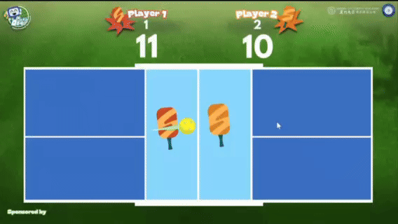

# dPickleball Tournament

**Visual tracking, hybrid physics prediction, and PPO self-play for dPickleball.**  
**視覚追跡・ハイブリッド物理予測・PPO セルフプレイによる dPickleball の強化学習。**

[English](#english) · [日本語](#日本語)

## Demo / デモ



## English

### Overview

This project contains Python training code for a two-player Unity dPickleball environment. It extracts the court, paddles, and ball from visual observations, constructs a compact state representation, and trains a Proximal Policy Optimization (PPO) agent with Stable-Baselines3.

The training pipeline combines:

- **HSV-based tracking:** OpenCV segmentation and contour analysis locate the court, ball, and paddles.
- **Hybrid physics prediction:** a four-state model distinguishes free flight, wall collision, paddle contact, and teleportation or missing detections, then estimates interception height and arrival time.
- **A 10-value observation:** player position, ball position, predicted interception height, arrival time, contact flag, normalized energy estimate, and opponent position. Horizontal coordinates and actions are mirrored when controlling the left player.
- **Self-play:** opponents are selected from saved PPO checkpoints, with an 80% preference for the newest checkpoint; a heuristic/random policy is used when no model is loaded.
- **Three reward styles:** `sparse`, `conservative`, and `aggressive`.

### Files

| File | Purpose |
| --- | --- |
| `train_ppo.py` | Unity startup, vectorized environments, PPO warm start, and training |
| `env_wrapper.py` | Gymnasium adapter, 10-value observations, side mirroring, and rewards |
| `tracker.py` | HSV segmentation and object tracking |
| `hybrid_physics_engine.py` | State transitions and reflected-trajectory prediction |
| `self_play_manager.py` | Checkpoint saving, opponent sampling, and fallback actions |
| `requirements.txt` | Python dependencies; install the custom ML-Agents package separately |
| `.gitignore` | Excludes local environments, models, logs, and Unity builds |
| `LICENSE` | MIT license |

### Requirements and setup

Use **Python 3.10.12** as a starting point. The [upstream setup instructions](https://github.com/dPickleball/dPickleBallEnv#installation-steps-to-set-up-dpickleball-environment) use this version, and the [custom ML-Agents package](https://github.com/dPickleball/dpickleball-ml-agents/blob/develop/ml-agents-envs/setup.py) specifies Python 3.10.1–3.10.12 and NumPy 1.23.5–<1.24.

You also need a compatible Unity dPickleball executable for your operating system. See the [upstream environment repository](https://github.com/dPickleball/dPickleBallEnv#usage) for build information. The supplied script currently contains a Windows `.exe` path; macOS and Linux require a compatible build and an updated path.

From this repository's root directory:

```bash
conda create -n dpickleball-ppo python=3.10.12 pip
conda activate dpickleball-ppo

git clone https://github.com/dPickleball/dpickleball-ml-agents.git external/dpickleball-ml-agents
python -m pip install -e ./external/dpickleball-ml-agents/ml-agents-envs -r requirements.txt
python -m pip check
```

The custom package supplies [`UnityParallelEnv`](https://github.com/dPickleball/dpickleball-ml-agents/blob/develop/ml-agents-envs/mlagents_envs/envs/unity_parallel_env.py) and [`CustomDataChannel` / `StringSideChannel`](https://github.com/dPickleball/dpickleball-ml-agents/blob/develop/ml-agents-envs/mlagents_envs/envs/custom_side_channel.py). Installing only the standard `mlagents-envs` distribution is not sufficient for these imports. This PPO pipeline imports `mlagents_envs`, not the separate `mlagents` trainer.

The dependency file is a starting specification, not a tested lockfile. NumPy and OpenCV versions follow the upstream instructions; the remaining package versions must be validated together with your Unity build and checkpoint. For an existing checkpoint, reuse the original training environment where possible. Both `gym` and `gymnasium` are imported by the supplied source.

### Training

1. In `train_ppo.py`, set `EXE_PATH` to your Unity executable.
2. Create `model_pool/` and place a compatible Stable-Baselines3 checkpoint at `model_pool/model_v0.zip`. The active code calls `PPO.load()` and requires this file. To train from scratch, replace the warm-start block with the commented `PPO(...)` constructor, and create `model_pool/` before training.
3. Adjust `num_envs`, `TOTAL_TIMESTEPS`, `FRAME_SKIP`, `SAVE_FREQ`, and the `agent_style` argument as needed. Keep the checkpoint observation/action spaces compatible with the wrapper.
4. Run from the repository root so that checkpoint and log paths resolve consistently:

```bash
python train_ppo.py
```

| Setting | Current source default |
| --- | --- |
| Environments | 8 Unity instances in `DummyVecEnv` (stepped sequentially) |
| Training timesteps | 1,000,000 |
| Frame skip | 2 |
| Checkpoint interval | 20,000 training timesteps |
| Reward style | `sparse`: +1 for a detected win, −1 for a detected loss |
| Opponent inference device | CPU |
| Base port argument | `5020 + worker_id`, passed together with `worker_id` |
| Initial checkpoint | `model_pool/model_v0.zip` |

The local `PORT = 5005` variable is unused. The active `PPO.load()` call does not explicitly receive the locally computed `device`, `policy_kwargs`, or `LOG_DIR`; those settings appear in the commented constructor. TensorBoard logging is therefore not explicitly enabled by the active training code.

Periodic checkpoints are written as `model_pool/model_v1.zip`, `model_v2.zip`, etc. Successful completion saves `alphazero_pickleball_champion.zip`; interruption during `model.learn()` saves `alphazero_interrupted_backup.zip`. These filenames are inherited from the source; the learning algorithm is PPO. Checkpoint numbering restarts at 1 on each run, so use a separate working copy or back up previous checkpoints before resuming.

### Current limitations and validation

The five Python source files are preserved as supplied. Before relying on training results, review these implementation details:

- Pixel normalization assumes a 168 × 84 image; HSV thresholds and court boundaries are hard-coded.
- `prev_ball` is set during reset but is not advanced in `step()`, so prediction does not consistently use consecutive ball positions.
- Paddle velocity in the contact branch subtracts the same stored position from itself, so the energy feature does not currently represent paddle motion.
- `SelfPlayCallback` and `_get_scripted_action` each have duplicate definitions; Python uses the later definition. The earlier callback's immediate opponent-loading behavior is therefore inactive.
- The scripted opponent receives `last_p_left` even when the opponent is on the right. Side-dependent behavior needs validation.
- The wrapper does not implement a `close()` override to forward cleanup to the Unity environment; confirm Unity processes and ports are released after training.

### License and upstream resources

This repository is distributed under the [MIT License](LICENSE), using the [standard MIT text](https://opensource.org/license/mit). External Unity builds, ML-Agents code, and other dependencies remain subject to their own licenses.

- [dPickleball environment and competition interface](https://github.com/dPickleball/dPickleBallEnv)
- [dPickleball ML-Agents fork](https://github.com/dPickleball/dpickleball-ml-agents)

## 日本語

### 概要

本プロジェクトは、Unity 上の 2 人対戦 dPickleball 環境向けの Python 学習コードです。画像観測からコート・パドル・ボールを検出し、コンパクトな状態表現を構築して、Stable-Baselines3 の Proximal Policy Optimization（PPO）でエージェントを学習します。

主な構成要素は次のとおりです。

- **HSV による視覚追跡：** OpenCV の色領域分割と輪郭解析でコート・ボール・パドルを検出します。
- **ハイブリッド物理予測：** 自由飛行、壁との衝突、パドル接触、テレポートまたは検出欠落の 4 状態を扱い、迎撃位置の高さと到達時間を推定します。
- **10 次元の観測：** 自機位置、ボール位置、予測迎撃高さ、到達時間、接触フラグ、正規化したエネルギー推定値、相手位置を使用します。左側を操作する際は、水平方向の座標と行動を反転します。
- **セルフプレイ：** 保存済み PPO モデルから対戦相手を選び、80% の確率で最新モデルを選択します。モデルが未読込の場合は、ルールと乱数を組み合わせた行動を使います。
- **3 種類の報酬設定：** `sparse`、`conservative`、`aggressive` に対応します。

### ファイル構成

| ファイル | 役割 |
| --- | --- |
| `train_ppo.py` | Unity 起動、ベクトル化環境、PPO モデルの読込と学習 |
| `env_wrapper.py` | Gymnasium アダプター、10 次元観測、左右反転、報酬 |
| `tracker.py` | HSV 領域分割と物体追跡 |
| `hybrid_physics_engine.py` | 状態遷移と反射軌道の予測 |
| `self_play_manager.py` | モデル保存、対戦相手の選択、代替行動 |
| `requirements.txt` | Python 依存関係。カスタム ML-Agents は別途導入が必要 |
| `.gitignore` | ローカル環境、モデル、ログ、Unity ビルドを Git の対象外に設定 |
| `LICENSE` | MIT ライセンス |

### 必要環境とセットアップ

まず **Python 3.10.12** を使用してください。[上流の導入手順](https://github.com/dPickleball/dPickleBallEnv#installation-steps-to-set-up-dpickleball-environment)で指定されているバージョンです。[カスタム ML-Agents パッケージ](https://github.com/dPickleball/dpickleball-ml-agents/blob/develop/ml-agents-envs/setup.py)は Python 3.10.1〜3.10.12、NumPy 1.23.5 以上 1.24 未満を要求します。

OS に対応した Unity dPickleball 実行ファイルも必要です。ビルドについては[上流の環境リポジトリ](https://github.com/dPickleball/dPickleBallEnv#usage)を参照してください。現行コードには Windows の `.exe` パスが記載されています。macOS / Linux では、対応するビルドの入手とパスの変更が必要です。

本リポジトリのルートディレクトリで実行します。

```bash
conda create -n dpickleball-ppo python=3.10.12 pip
conda activate dpickleball-ppo

git clone https://github.com/dPickleball/dpickleball-ml-agents.git external/dpickleball-ml-agents
python -m pip install -e ./external/dpickleball-ml-agents/ml-agents-envs -r requirements.txt
python -m pip check
```

カスタムパッケージには [`UnityParallelEnv`](https://github.com/dPickleball/dpickleball-ml-agents/blob/develop/ml-agents-envs/mlagents_envs/envs/unity_parallel_env.py) と [`CustomDataChannel` / `StringSideChannel`](https://github.com/dPickleball/dpickleball-ml-agents/blob/develop/ml-agents-envs/mlagents_envs/envs/custom_side_channel.py) が含まれています。標準の `mlagents-envs` を導入するだけでは、必要なインポートを満たせません。この PPO パイプラインが使用するのは `mlagents_envs` であり、別パッケージの `mlagents` トレーナーではありません。

依存関係ファイルは導入の出発点であり、動作検証済みのロックファイルではありません。NumPy と OpenCV のバージョンは上流の手順に合わせています。その他の依存関係は Unity ビルドおよびチェックポイントと組み合わせて検証してください。既存モデルを使用する場合は、可能な限り元の学習環境を再利用してください。現行ソースは `gym` と `gymnasium` の両方をインポートします。

### 学習方法

1. `train_ppo.py` の `EXE_PATH` を Unity 実行ファイルのパスに変更します。
2. `model_pool/` を作成し、互換性のある Stable-Baselines3 チェックポイントを `model_pool/model_v0.zip` に配置します。現行コードは `PPO.load()` を呼ぶため、このファイルが必須です。新規学習する場合は、モデル読込部分をコメント内の `PPO(...)` コンストラクターに置き換え、学習前に `model_pool/` を作成してください。
3. 必要に応じて `num_envs`、`TOTAL_TIMESTEPS`、`FRAME_SKIP`、`SAVE_FREQ`、`agent_style` 引数を調整します。モデルの観測空間・行動空間をラッパーと一致させてください。
4. 相対パスを正しく解決するため、リポジトリのルートから実行します。

```bash
python train_ppo.py
```

| 設定 | 現行コードの既定値 |
| --- | --- |
| 環境数 | `DummyVecEnv` 内の Unity 8 インスタンス（逐次実行） |
| 学習ステップ数 | 1,000,000 |
| フレームスキップ | 2 |
| モデル保存間隔 | 学習 20,000 ステップごと |
| 報酬設定 | `sparse`：勝ちの検出で +1、負けの検出で −1 |
| 対戦相手の推論デバイス | CPU |
| 基準ポート引数 | `5020 + worker_id` を `worker_id` とともに指定 |
| 初期チェックポイント | `model_pool/model_v0.zip` |

ローカル変数 `PORT = 5005` は未使用です。現行の `PPO.load()` には、ローカルで計算した `device`、`policy_kwargs`、`LOG_DIR` が明示的に渡されていません。これらはコメント内のコンストラクターで使用する設定です。そのため、現行の学習処理では TensorBoard ログの出力を明示的に有効化していません。

定期保存先は `model_pool/model_v1.zip`、`model_v2.zip` などです。正常終了時は `alphazero_pickleball_champion.zip`、`model.learn()` 中の中断時は `alphazero_interrupted_backup.zip` に保存します。ファイル名は元のコードに由来しますが、学習アルゴリズムは PPO です。モデルの連番は実行ごとに 1 から始まるため、再開前に以前のモデルをバックアップするか、別の作業コピーを使用してください。

### 現状の制約と検証範囲

5 つの Python ソースファイルは、提供された内容をそのまま収録しています。学習結果を利用する前に、以下の実装を確認してください。

- 座標の正規化は 168 × 84 の画像を前提とし、HSV 閾値とコート境界は固定値です。
- `prev_ball` はリセット時に設定されますが、`step()` 内で更新されないため、予測が常に連続フレームの位置を使うわけではありません。
- 接触状態のパドル速度計算では同じ保存位置同士を減算しており、エネルギー特徴量は現状ではパドルの動きを表していません。
- `SelfPlayCallback` と `_get_scripted_action` はそれぞれ重複定義されており、後の定義が使用されます。前のコールバックにある対戦相手の即時読込処理は有効ではありません。
- 対戦相手が右側にいる場合も、ルールベースの行動処理には `last_p_left` が渡されます。左右での挙動を検証する必要があります。
- ラッパーには Unity 環境へ終了処理を転送する `close()` のオーバーライドがありません。終了後に Unity プロセスとポートが解放されることを確認してください。

### ライセンスと関連リソース

本リポジトリは、[標準の MIT 文面](https://opensource.org/license/mit)に基づく [MIT ライセンス](LICENSE)で公開します。外部の Unity ビルド、ML-Agents コード、その他の依存関係には、それぞれのライセンスが適用されます。

- [dPickleball 環境と大会インターフェース](https://github.com/dPickleball/dPickleBallEnv)
- [dPickleball ML-Agents フォーク](https://github.com/dPickleball/dpickleball-ml-agents)
